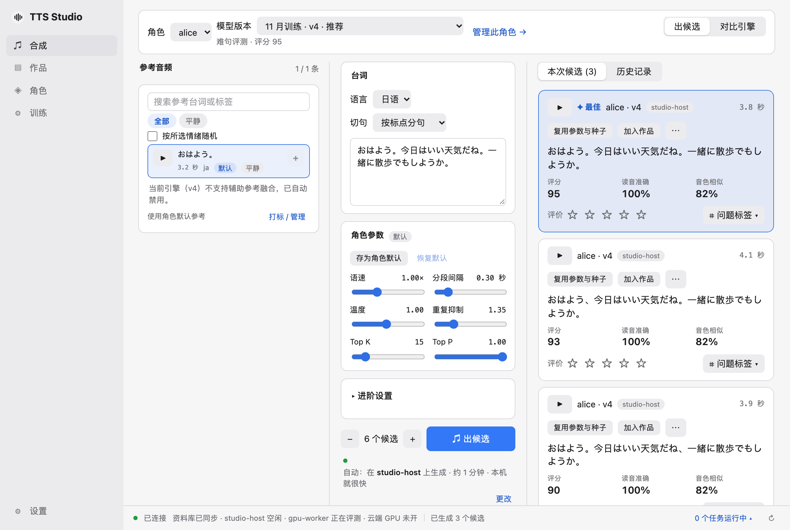
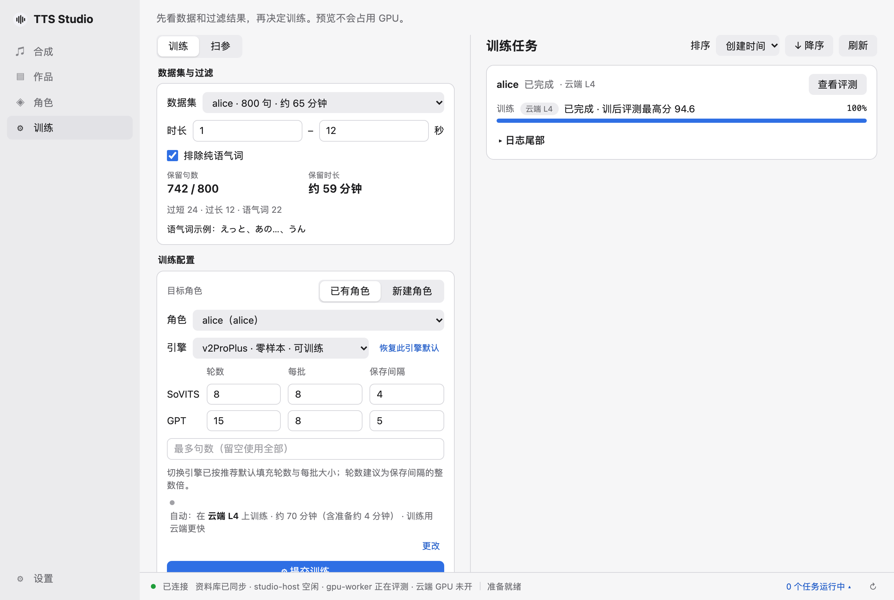
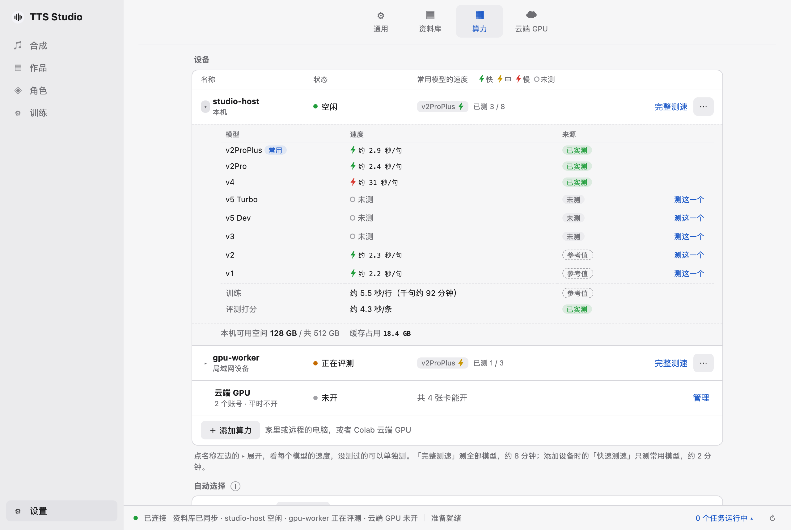
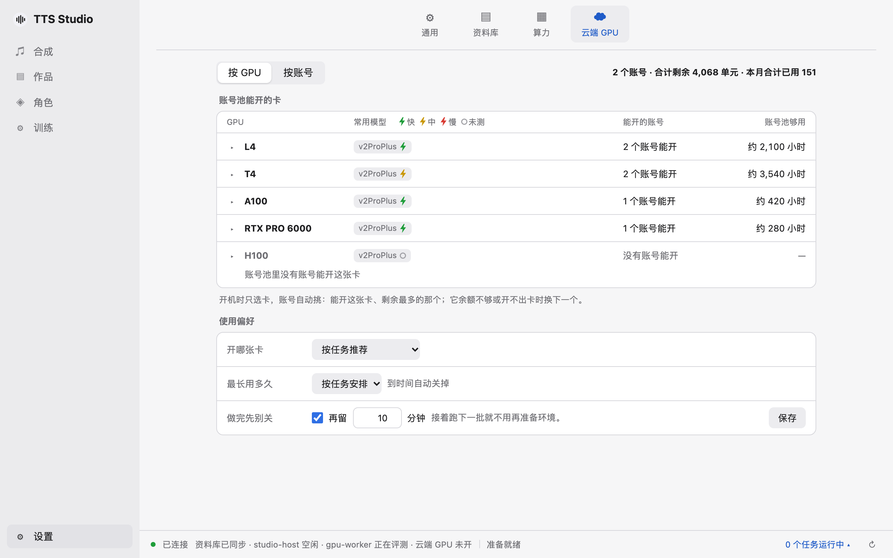

<div align="center">

# TTS Studio

**面向 [GPT-SoVITS](https://github.com/RVC-Boss/GPT-SoVITS) 的多端语音合成、评测与训练工作台**

原生 macOS 客户端 · 桌面 / 移动端 Web 界面 · 文件夹资料库 · 局域网算力 & Google Colab GPU 调度

[](LICENSE)
[](https://github.com/dreaifekks/tts-studio/releases)
[](https://github.com/RVC-Boss/GPT-SoVITS)
[](#仓库结构)
[](#仓库结构)

[功能特性](#功能特性) · [界面预览](#界面预览) · [架构与目录](#仓库结构) · [快速开始](#快速开始) · [开发与测试](#测试)

</div>

---

## 界面预览



| 训练与数据集过滤预览 | 多算力设备与引擎测速 |
| :---: | :---: |
|  |  |

| Google Colab 云端 GPU 账号池 |
| :---: |
|  |

## 功能特性

- **语音合成与自动筛选**：支持 `v1`、`v2`、`v2Pro`、`v2ProPlus`、`v3`、`v4`、`v5turbo`、`v5dev` 引擎；一次生成多条候选并自动计算读音准确度与音色相似度，支持多引擎对比、快捷键试听评分、辅助参考融合及推理调试视图。
- **作品编排与导出**：多行台词编辑、拖动排序、整篇或单行重生成、逐行挑选候选、整轨试听及音频 / SRT 字幕导出。
- **角色、参考库与模型评测**：参考音频试听与情绪标签管理、多权重组合批量评测、A/B 盲听测试、历史记录复用与多维度评分统计。
- **训练与扫参**：数据集时长与语气词过滤预览、LoRA / 全量微调与超参数扫描、SSE 实时进度日志以及训后自动评测。
- **文件夹资料库**：角色、参考音频、数据集、权重、评测、盲听和作品全部以透明文件格式保存在单一文件夹中，支持本机目录或云盘同步目录（如 Google Drive）。
- **多算力调度**：自动估算并调度本机、局域网 / Tailscale 远程设备（一行命令配对安装，支持 Wake-on-LAN）以及 Google Colab 云端 GPU 账号池（T4 / L4 / A100 / RTX PRO 6000 / H100）。

## 仓库结构

| 目录 | 说明 | 文档 |
| --- | --- | --- |
| `core/` | Python FastAPI 后端服务：推理 / 评分 / 训练 worker、资料库、多算力与 Colab 调度 | [core/README.md](core/README.md) |
| `mac/` | 原生 macOS SwiftUI 客户端（支持本机主控一键安装或连接远程主控） | [mac/README.md](mac/README.md) |
| `web/` | React + TypeScript + Vite 浏览器客户端，由主控在 `/ui/` 提供 | [web/README.md](web/README.md) |
| `api/openapi.json` | Core HTTP 接口的 OpenAPI 快照（Mac 与 Web 类型生成来源） | — |

```text
Mac App (SwiftUI) ──┐
                    ├── HTTP / SSE ──▶ TTS Studio Core (主控) ──▶ 资料库文件夹（本地 / 云盘）
Web UI (/ui/)     ──┘                         │
                         ┌────────────────────┼────────────────────┐
                         ▼                    ▼                    ▼
                  本机推理 / 评分       局域网 / Tailscale      Google Colab GPU
                  (MPS / CUDA / CPU)    Worker 设备 (LAN)      临时训练 / 推理 / 评测
```

## GPT-SoVITS 依赖

安装脚本会自动拉取上游 [`RVC-Boss/GPT-SoVITS@bf81cdb`](https://github.com/RVC-Boss/GPT-SoVITS/commit/bf81cdb14a38b674b6e9996dabc97340bc9978d2)，并应用仓库内的兼容性补丁 [`core/patches/gptsovits-bf81cdb.patch`](core/patches/gptsovits-bf81cdb.patch)（启用 `v5turbo` / `v5dev` 时按需拉取上游 V5）。

## 快速开始

### 方式 A：macOS 客户端（推荐 macOS）

通过 Homebrew 安装（已签名并经 Apple 公证，自动安装 `ffmpeg` 和 `uv`）：

```sh
brew install --cask dreaifekks/tap/tts-studio
```

或前往 [Releases](https://github.com/dreaifekks/tts-studio/releases) 手动下载 `TTSStudio-*-macos-arm64.dmg` 拖入 `/Applications`。首次启动选择「作为主控」即可在应用内一键安装并管理本机 Core 与 Web 界面，也可选择「连接到另一台」远程主控。

### 方式 B：Docker 部署（推荐 Linux / NVIDIA GPU）

```sh
git clone https://github.com/dreaifekks/tts-studio.git
cd tts-studio

# NVIDIA GPU（CUDA 12.8）
docker compose up -d

# 仅 CPU
docker compose --profile cpu up -d
```

启动后浏览器打开 `http://localhost:9880/ui/`（首次启动会自动下载 `TTSAPI_ENGINES` 指定的底模到 `./models` 持久化卷）。也可直接拉取预构建镜像：`ghcr.io/dreaifekks/tts-studio:latest`（CUDA）或 `:cpu`。

### 方式 C：从源码安装 Core 服务（macOS / Linux）

前置依赖：`git`、`curl`、`uv`、`ffmpeg`（macOS 另需 Xcode Command Line Tools）。

```sh
git clone https://github.com/dreaifekks/tts-studio.git
cd tts-studio/core

# macOS（Apple Silicon）
GSV_ROOT="$HOME/GPT-SoVITS" ENGINES=v2pro,v2proplus bash scripts/install_macos.sh

# Linux（自动检测 NVIDIA CUDA 12.8 或 CPU）
GSV_ROOT="$HOME/GPT-SoVITS" ENGINES=v2pro,v2proplus bash scripts/install_linux.sh
```

启动主控并初始化资料库目录：

```sh
TTSAPI_HOST=127.0.0.1 TTSAPI_INSTALL_PORT=0 \
  TTSAPI_GSV_ROOT="$HOME/GPT-SoVITS" \
  "$HOME/GPT-SoVITS/.venv/bin/python" -m ttsapi.gateway
```

在另一个终端绑定资料库目录：

```sh
curl -fsS http://127.0.0.1:9880/health
curl -fsS -X POST http://127.0.0.1:9880/library \
  -H "Content-Type: application/json" \
  -d "{\"path\":\"$HOME/tts-library\"}"
```

更多配置（开机自启、局域网 worker 配对、Colab GPU、V5 引擎）见 [core/README.md](core/README.md)。

### 从源码构建 Mac 客户端（macOS）

前置依赖：Apple Silicon Mac、支持 Swift 6 的 Xcode（如希望随包内嵌 Web 界面，另需 Node.js 22.12+）。

```sh
cd tts-studio/mac
./script/install.sh
open /Applications/TTSStudio.app
```

首次启动可选择「作为主控」（支持在应用内安装并管理本机 Core）或「连接到另一台」。详见 [mac/README.md](mac/README.md)。

### 从源码构建或本地开发 Web 界面

```sh
cd tts-studio/web
npm ci
npm run build        # 产物在 web/dist/，主控 Core 自动挂载到 /ui/
npm run dev          # 本地开发服务器 http://localhost:5173/ui/
```

详见 [web/README.md](web/README.md)。

## 测试

```sh
# Core 单元测试
cd core && "$HOME/GPT-SoVITS/.venv/bin/python" -m pytest tests/unit ttsapi/compute/colab/test_colab.py tests/colab_sim

# Mac 单元测试
cd mac && xcodebuild -project TTSStudio.xcodeproj -scheme TTSStudio -configuration Debug \
  -derivedDataPath "$HOME/Library/Caches/TTSStudio/Tests.noindex" -destination "platform=macOS" test

# Web 类型检查、Lint、单测与构建
cd web && npm run typecheck && npm run lint && npm run test:blind && npm run build
```

## 致谢与协议

- 语音合成与训练引擎基于 [RVC-Boss/GPT-SoVITS](https://github.com/RVC-Boss/GPT-SoVITS)（MIT License）。
- 本项目采用 [Apache License 2.0](LICENSE) 开源（含 [NOTICE](NOTICE)）。
